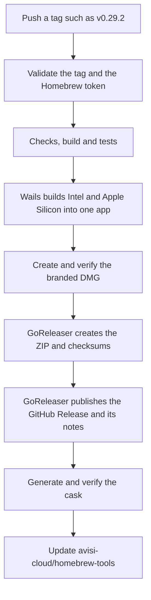

# Releases and repository setup

To release, push a version tag. GitHub Actions builds the app, publishes the
GitHub Release with its downloads and release notes, and updates the Homebrew
cask. Nobody builds or uploads the production app by hand.

```sh
git switch main && git pull
git tag v0.29.2
git push origin v0.29.2
```



Pick the version from the commits since the last tag. While the app is below
1.0, features and fixes bump the patch version; breaking changes bump the minor
version. Only stable tags such as `v0.29.2` publish; the workflow rejects other
`v*` tags. Tag a commit on `main` that has passed its checks.

## One-time GitHub setup

1. Enable GitHub Actions and use `main` as the default branch. Enable squash
   merging and use the pull request title as the squash commit title.
2. Install or enable the [Renovate GitHub app](https://github.com/apps/renovate)
   for this repository. `renovate.json` controls dependency update PRs; merely
   committing the file does not activate the app.
3. Require the `Conventional Commit title`, `Frontend checks` and
   `macOS checks and release rehearsal` checks in the branch rules for `main`.
   Branch rules need a public repository or a paid plan; until then these run on
   every pull request but cannot be enforced.
4. Configure the Homebrew secret below in
   **Settings > Secrets and variables > Actions**, before the first release.

| Secret                        | Repository access            | Fine-grained token permissions |
| ----------------------------- | ---------------------------- | ------------------------------ |
| `HOMEBREW_TOOLS_GITHUB_TOKEN` | `avisi-cloud/homebrew-tools` | Contents: read/write           |

`acloud-toolkit` uses a secret with the same name, so you can reuse its token.
Use an organisation-approved automation account for it. Organisation policies
may require approval of the token or permission for the account to push to the
tap. As in `acloud-toolkit`, the workflow checks the token first and fails
before building when it is missing or cannot read the tap.

The release itself uses the `GITHUB_TOKEN` that GitHub provides, so you need
no personal release token. A tag that a person pushes starts the workflow. A tag
that another workflow pushes with `GITHUB_TOKEN` does not, because GitHub
suppresses those [workflow triggers](https://docs.github.com/en/actions/how-tos/write-workflows/choose-when-workflows-run/trigger-a-workflow).

## What each tool does

| Tool                         | Responsibility                                                                   |
| ---------------------------- | -------------------------------------------------------------------------------- |
| Wails                        | Bindings, frontend build, native Go build, universal binary and `.app` packaging |
| `create-dmg`                 | Branded drag-to-Applications disk image with the same universal app              |
| GoReleaser v2 OSS            | ZIP archive, SHA-256 checksums, release notes and the GitHub Release             |
| `generate-homebrew-cask.mjs` | An app cask using the archive's actual SHA-256                                   |
| GitHub Actions               | Tag trigger, checks, artifact verification and Homebrew update                   |
| Renovate                     | Dependency update PRs; no automatic merging                                      |

`.goreleaser.yaml` follows `acloud-toolkit`. GoReleaser creates the release for
a tag and writes its notes from the commits since the previous tag, grouped by
Conventional Commit type. This app is a Wails `.app` rather than a Go CLI, so two
things differ:

- `.goreleaser.yaml` skips GoReleaser's build stage. Its `before` hook runs
  `make dmg`, which builds the universal app through Wails's
  `darwin:package:universal` and packages the DMG. GoReleaser archives that
  bundle and adds the DMG to the checksums and the release.
- `generate-homebrew-cask.mjs` writes the cask instead of GoReleaser's
  `homebrew_casks`. In GoReleaser OSS that section only installs binaries, and
  the `app` stanza a `.app` needs is a
  [GoReleaser Pro feature](https://goreleaser.com/customization/homebrew_casks/).
  The workflow pushes the generated cask to `Casks/acloud-playrooms.rb` in the
  same tap as `acloud-toolkit`.

## Versioning

The tag is the version. Release builds use it for both bundle version fields
before signing, and for the download filenames. Local `make` builds default to
the latest release tag, or to the version in `build/config.yml` when no tags are
fetched. The sidebar's acloud version describes the separately installed CLI,
not the GUI.

Release notes come from the commit subjects, so use
[Conventional Commit titles](../CONTRIBUTING.md#pull-request-titles).
`CHANGELOG.md` lists the releases up to 0.29.1, which Release Please made.
Later notes are on the GitHub Releases page. This pipeline does not
publish prereleases to the shared Homebrew cask.

## Try a release locally

On macOS with Go, Node.js, Python 3.10+, Xcode Command Line Tools, GoReleaser v2 and
`create-dmg` installed:

```sh
brew install create-dmg
make release-snapshot
```

This produces a branded DMG under `bin/`, and a ZIP, checksums and a generated
cask under `dist/`. Both downloads contain the same universal `.app`; Homebrew
uses the ZIP. Verification checks both checksums, bundle metadata, both CPU architectures,
ad-hoc signatures, and cask syntax. It mounts the DMG read-only and checks its
Applications shortcut, artwork, legal notices, and persisted Finder layout,
then detaches it. Nothing is published.
Snapshot casks are for inspection; their download URLs are not published releases.

The build also fails when the regenerated `frontend/bindings` differ from what
is committed. GitHub runs the same rehearsal for pull requests, and also runs Go
vet and race tests and the frontend's formatter, linter, production build and
tests.

## Change the app icon

The app carries two macOS icons. `build/darwin/icons.icns` is made from
`build/appicon.png` on every build. `build/darwin/Assets.car` is the macOS 26
icon, compiled from `build/appicon.icon`, and is committed: GitHub's macOS 15
runners cannot compile an `.icon`, so releases ship the committed file, and
local builds now copy the same one instead of compiling their own.

After changing `appicon.icon`, run this on macOS 26 with Xcode 26 and commit
`build/darwin/Assets.car`:

```sh
make mac-icon-assets
```

`actool` writes a slightly different file on every run, so only commit it when
the icon itself changed.

## Build or edit the installer

```sh
make dmg
```

This builds and verifies `bin/acloud-playrooms_<version>_darwin_universal.dmg`.
Use `make dmg VERSION=0.28.2` to override the configured application version.
Packaging uses `create-dmg` with a real Applications shortcut and the existing
app icon as the mounted volume icon. LICENSE and NOTICE are included in the
hidden `.legal` directory on the disk image.

The editable artwork is `build/darwin/dmg/background.html`. It references the
existing `AvisiBackground.webp`, white Avisi mark, and vendored Poppins fonts.
To regenerate the committed PNG preview and TIFF background on macOS:

```sh
swift scripts/render-dmg-background.swift
```

The TIFF contains 720 × 480 and 1440 × 960 representations for standard and
Retina displays. Release builds use this committed file without rendering HTML
or installing artwork tools. Keep the artwork's icon wells aligned with the
positions in `scripts/dmg-layout.py` when editing the layout.

Packaging and verification do not require permission to control Finder. The
first build installs the pinned `ds-store` and `mac-alias` Python libraries into
`bin/dmg-tools/`; subsequent builds reuse them. `create-dmg` makes a writable
image with its Finder automation disabled. The packaging script then writes
the background alias, window settings and icon positions directly into
`.DS_Store` and compresses the finished image. Verification reads these settings
back and fails if the design is missing. The final visual check is to open the
DMG in Finder yourself.

The background also has a Finder bookmark tied to the disk image's volume UUID.
This prevents a second mounted build from borrowing an older build's background.
Verification uses macOS's native bookmark resolver, checks that it resolves to
the mounted image being tested, and checks artwork dimensions and content.

The saved opening size is 720 × 512 points, including a 32-point Finder title
bar, so the full 720 × 480 artwork is visible. Finder still allows users to resize
its window or drag icons; a DMG cannot enforce a fixed window size or make its
bitmap background responsive. Eject previous copies before a visual test to
avoid reopening an older mounted build.

## Retry a release

Open **Actions > Publish release > Run workflow** and enter an existing stable
tag, for example `v0.29.2`. The job checks out that tag, repeats validation and
the build, and replaces the release's files. GoReleaser keeps release notes
that already exist. It updates the Homebrew cask only when its content changes.

GoReleaser publishes the release before the workflow updates the cask. If a
step after that fails, retry the tag after resolving the cause. If
the source itself needs a fix, merge the fix and tag a new version instead of
moving the old tag.

## macOS signing and quarantine

The current app is **ad-hoc signed**, not signed with an Apple Developer ID and
not notarized by Apple. The same distinction applies whether the code is public
or private: publishing source does not establish a trusted macOS signature.

The cask's `postflight` runs `xattr -dr com.apple.quarantine` only on the installed
`Acloud Playrooms.app`. This adapts the workaround used by `acloud-toolkit` to
an application bundle. It removes the download quarantine marker for Homebrew
installs; it does not make the app Apple-approved, and other device policies may
still block it. Nothing disables Gatekeeper globally.

A direct browser download does not run that cask hook. Users can follow Apple's
[instructions for opening an app from an unidentified developer](https://support.apple.com/en-us/102445)
after checking the source of the download.

For trusted distribution without this workaround, the next step is an Apple
Developer ID certificate and notarization credentials. Wails already includes
`darwin:sign` and `darwin:sign:notarize` tasks in `build/darwin/Taskfile.yml`.
CI would need to import the certificate into a temporary keychain, sign the
universal bundle, notarize and staple it before archiving, then remove the cask's
quarantine hook. These credentials are not required by the current workflow.
